<a href="https://nathanm95.github.io">
  
</a>

  
  
  

I take organisations from spreadsheets and disconnected systems to purpose-built Salesforce platforms. I work across the whole job: the architecture and the roadmap, the hands-on Apex, LWC and Flow, and the board-level conversation about what the platform can actually do.

Right now I'm the **Salesforce Administrator at The Royal Institution**. Previously a founding team member and **Solutions Architect at Apex Infinity Solutions**, a Salesforce partner.


### 🛠️ Toolkit

**Clouds:** Sales · Service · Experience · Marketing · Digital Engagement

### 🏗️ Featured build: three systems, one org

A housing partner in Kent providing accommodation for 25+ local authorities across the South-East. Their whole operation ran across two legacy systems and a wall of spreadsheets. I led the build that moved all of it onto a single Salesforce org.

- 🔀 **Consolidation:** migrated everything into one org, with a clean council account hierarchy
- 📋 **Booking lifecycle:** a staged pipeline from available void to sign-out
- 🛡️ **Safeguarding flags:** dated duty-of-care banners on booking and property pages
- 🤖 **AI repairs triage:** tenants troubleshoot with an AI tool before a site visit is booked
- ✅ **Compliance on autopilot:** the next gas safety certificate is created as soon as the last one closes
- 🌐 **Council portal:** Experience Cloud self-service for bookings, certificates and standards
- 📊 **Void board:** a live vacancy and revenue dashboard, on screen in the office every day

➡️ [Read the full case study](https://nathanm95.github.io/#project)


---

### 🎲 Fun stuff: Pebble development, 2014 → 2026

Away from Salesforce I write watch apps and games in C for Pebble. I started in 2014 on the original watches and CloudPebble, and I'm still at it on the new Pebble Time 2 and Round 2. I have 15 apps and watchfaces live on the Rebble appstore.


**[Dicey Depths](https://apps.repebble.com/dicey-depths_63d47f8fc443434eb3970e6f)** is a dice roguelike inspired by Terry Cavanagh's *Dicey Dungeons*. You're a walking six-sided die on a game show. Every turn you roll your dice face up, *then* decide how to spend them across your equipment cards. A bad roll becomes a puzzle rather than a punishment. Play as the Warrior, who rerolls, or the Robot, who builds each number on a CPU meter and goes bust past six. There are five episodes that each rewrite the rules and end in a boss, plus an endless mode. Version 1.2 repainted every menu.

  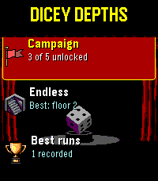
  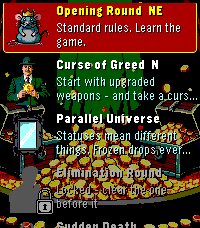
  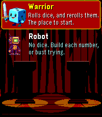
  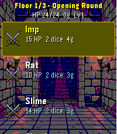
  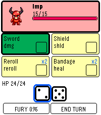
  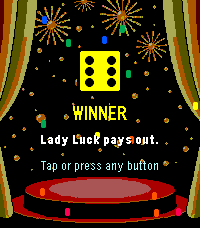

**Also on my wrist.** Everything here is on the Rebble store, so click a card to open its listing.

  <a href="https://apps.repebble.com/peggle_275f646efb0746409f30b20d">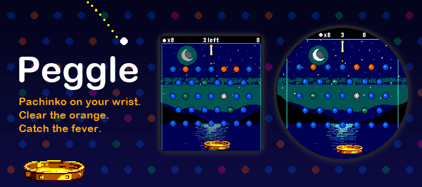</a>
  <a href="https://apps.repebble.com/zuma_5c9cb5012cc445cf97435dc2">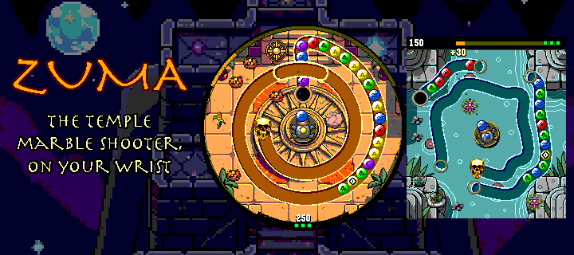</a>

  <a href="https://apps.repebble.com/slither_34ddd0970bd04608bbd6682f">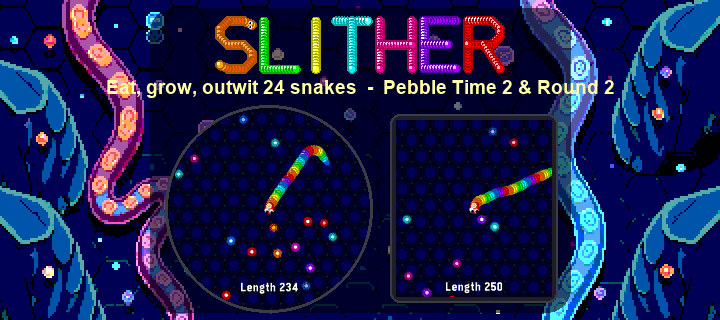</a>
  <a href="https://apps.repebble.com/dicey-depths_63d47f8fc443434eb3970e6f">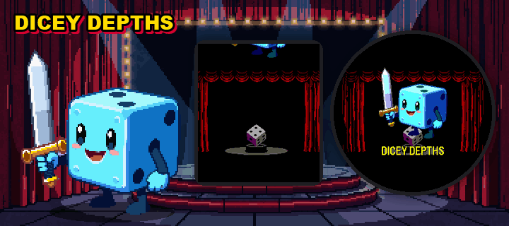</a>

  <a href="https://apps.repebble.com/orbital_ca95ffb257bb4ae484d2de7f">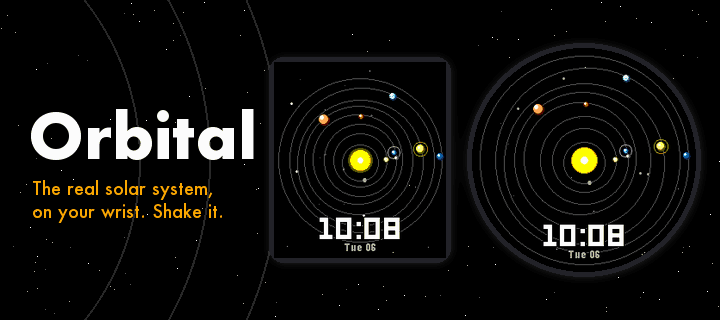</a>
  <a href="https://apps.repebble.com/desk-cat_fd38ddf3974e433a8a1fdec4">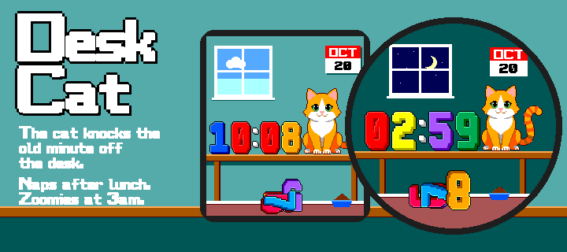</a>

  <a href="https://apps.repebble.com/lava-lamp_21794a91d4da4b669c2c3239">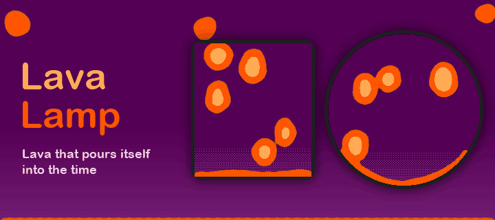</a>
  <a href="https://apps.repebble.com/snow_bb08f60115414d268f62841a">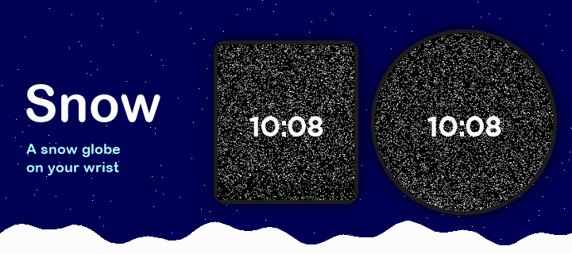</a>

  <a href="https://apps.repebble.com/orbi_af0517c065c24fd7b83e9677">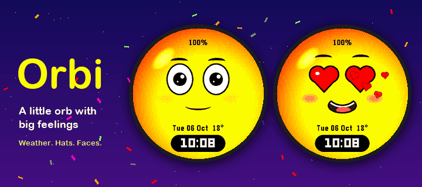</a>
  <a href="https://apps.repebble.com/pumpkin-orbi_469bd3411da64a6195abeffb">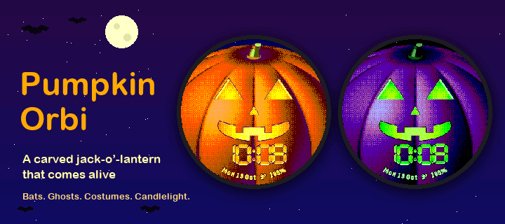</a>

  <a href="https://apps.repebble.com/premier-league_58f3c6203e5e4b9da769b4f9">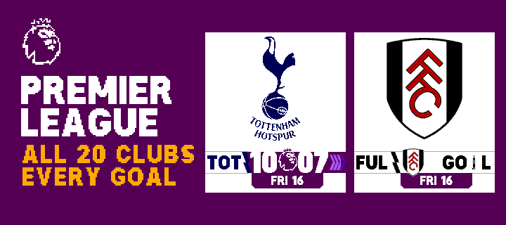</a>
  <a href="https://apps.repebble.com/roulette_b89bf994105f420b9c2a611f">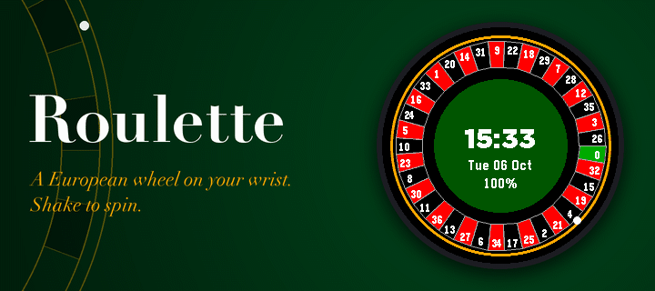</a>

  <a href="https://apps.repebble.com/facilitate-fitness-2_41efeb5b0334485fa47a23e5">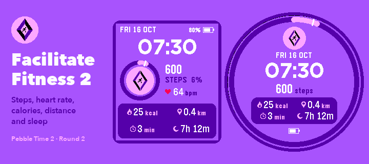</a>
  <a href="https://apps.repebble.com/black-parade_73b4a8245cb742ff8c15e860">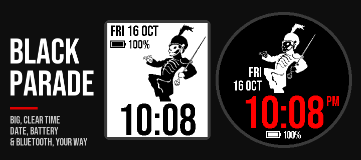</a>

**Games**

- 🎯 **[Peggle](https://apps.repebble.com/peggle_275f646efb0746409f30b20d)** fires balls through boards of pegs. Clear the orange, catch the fever, and take on the daily challenge or an Endless run.
- 🐸 **[Zuma](https://apps.repebble.com/zuma_5c9cb5012cc445cf97435dc2)** is the classic marble shooter. You're a stone frog with five temples of levels to save, plus an endless Gauntlet.
- 🐍 **[Slither](https://apps.repebble.com/slither_34ddd0970bd04608bbd6682f)** is a snake arena for the touchscreen Pebbles. You steer with your finger, grow huge, and make 24 rival snakes crash into you.
- 🎲 **[Dicey Depths](https://apps.repebble.com/dicey-depths_63d47f8fc443434eb3970e6f)** is the dice roguelike above.
- 🎾 **Pebble Tennis Tour** is a tennis RPG where you climb a five-tier tour ladder. It's still in the workshop.

**Watchfaces**

- 🪐 **[Orbital](https://apps.repebble.com/orbital_ca95ffb257bb4ae484d2de7f)** shows the eight planets where they really are today, worked out on the watch. Shake it and they fall loose under real gravity, then glide home.
- 🐱 **[Desk Cat](https://apps.repebble.com/desk-cat_fd38ddf3974e433a8a1fdec4)** has a cat that knocks the old minute off the desk, every minute. It naps after lunch and gets the zoomies at 3am.
- 🌋 **[Lava Lamp](https://apps.repebble.com/lava-lamp_21794a91d4da4b669c2c3239)** fills the screen with drifting molten blobs that pour themselves into the time when you glance at it.
- ❄️ **[Snow](https://apps.repebble.com/snow_bb08f60115414d268f62841a)** is a snow globe that piles up on the digits as you tilt your wrist. It's my port of Leo Vandriel's 2013 face.
- 🙂 **[Orbi](https://apps.repebble.com/orbi_af0517c065c24fd7b83e9677)** is a little orb with big feelings. He knows the weather, puts on hats and throws a party on the hour.
- 🎃 **[Pumpkin Orbi](https://apps.repebble.com/pumpkin-orbi_469bd3411da64a6195abeffb)** is Orbi's spooky cousin, a carved jack-o'-lantern. Bats pour out of his mouth, and he dresses up as a witch, a vampire and a mummy.
- ⚽ **[Premier League](https://apps.repebble.com/premier-league_58f3c6203e5e4b9da769b4f9)** puts your club's crest over the TV scorebug, with the time as the score. Every hour your club scores, and all 20 clubs have their own goal animation.
- 🎡 **[Roulette](https://apps.repebble.com/roulette_b89bf994105f420b9c2a611f)** is a European wheel watchface. Shake to spin, and the winning number comes up above the clock.
- 🏃 **[Facilitate Fitness 2](https://apps.repebble.com/facilitate-fitness-2_41efeb5b0334485fa47a23e5)** is my 2017 step face, rebuilt from scratch. It shows steps against your goal on a ring, plus heart rate, calories, distance and sleep.
- 💀 **[Black Parade](https://apps.repebble.com/black-parade_73b4a8245cb742ff8c15e860)** is a tribute to My Chemical Romance's *The Black Parade*. It puts the marching skeleton behind a big, clear clock, on every Pebble.

